<a href="https://mathyouandre.fr/">
  <picture>
    <source media="(prefers-color-scheme: dark)" srcset="assets/entete-sombre.svg" />
    <source media="(prefers-color-scheme: light)" srcset="assets/entete-clair.svg" />
    
  </picture>
</a>

Entre systèmes, réseaux et informatique, je développe mes compétences au quotidien à travers ma formation et mes projets personnels. Bac Pro CIEL mention Très Bien, aujourd'hui en **BTS SIO option SISR** à Saint-Étienne.

```console
mathh@SW-01# show interfaces status
Port    Nom             Statut      Détail
Gi0/1   systemes        connected   Windows Server, Linux, Active Directory
Gi0/2   reseaux         connected   switchs, brassage RJ45, DHCP
Gi0/3   electronique    connected   ESP32, Raspberry Pi Pico, Arduino
Gi0/4   hack-the-box    connected   34 machines, rang Hacker
```

### Projets

Des besoins perso qui finissent en objets connectés, en domotique ou en petits outils.

| Projet | En bref |
| --- | --- |
| [**CYD-Buttons-HA**](https://github.com/mathyouadr/CYD-Buttons-HA) | Télécommande tactile pour Home Assistant sur écran ESP32 Cheap Yellow Display (ESPHome, LVGL). |
| [**CYD MQTT Display**](https://github.com/mathyouadr/cyd-mqtt-display) | Écran ESP32 piloté par MQTT (TLS) depuis Discord ou un PC : texte, image, buzzer. |
| [**Prototype Pointeuse RFID**](https://github.com/mathyouadr/Prototype-Pointeuse) | Pointeuse et suivi d'outillage par badge sur ESP32 + RC522, autonome : WiFi, interface web, annonces vocales. |
| [**MacroPad**](https://github.com/mathyouadr/MacroPad) | Pavé de 9 touches sur Raspberry Pi Pico (CircuitPython), avec configurateur PC, PCB et boîtier 3D. |
| [**Lecteur PDF à voix haute**](https://github.com/mathyouadr/lecteur-pdf) | Application web auto-hébergée qui lit des livres PDF phrase par phrase, avec reprise de lecture. |
| [**Puff connecté**](https://github.com/mathyouadr/puff-connecte) | Une puff rechargeable transformée en interrupteur Home Assistant par un ESP32. |

Chaque projet a sa page détaillée sur [mathyouandre.fr/projets](https://mathyouandre.fr/projets/).

### Outils

<p>
  
  
  
  
  
  
  
  
  
  
  
</p>

### Hack The Box

<a href="https://app.hackthebox.com/users/1959749">
  
</a>

<br /><br />

<picture>
  <source media="(prefers-color-scheme: dark)" srcset="https://raw.githubusercontent.com/mathyouadr/mathyouadr/output/github-snake-dark.svg" />
  <source media="(prefers-color-scheme: light)" srcset="https://raw.githubusercontent.com/mathyouadr/mathyouadr/output/github-snake.svg" />
  
</picture>

---

[](https://mathyouandre.fr/)
[](https://www.linkedin.com/in/mathyoua/)
[](mailto:andremathyoupro@gmail.com)
